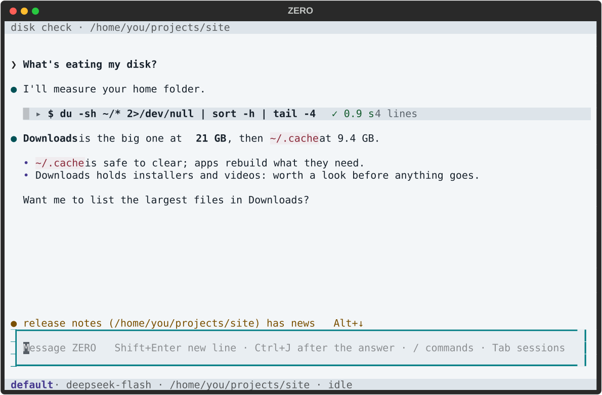

<p align="center">
  <picture>
    <source media="(prefers-color-scheme: dark)" srcset="docs/media/zero-logo-dark.svg">
    
  </picture>
</p>

<h3 align="center">A general purpose agent.</h3>
<p align="center"><sub>Zealous Efferent Response Operator</sub></p>

<p align="center">
  <a href="#install"><b>Install</b></a> · <a href="#use">Use</a> · <a href="#for-other-agents">For other agents</a> · <a href="#update">Update</a> · <a href="CHANGELOG.md">Changelog</a>
</p>

<p align="center">
  
  
  <a href="LICENSE"></a>
</p>

<p align="center">
  <picture>
    <source media="(prefers-color-scheme: dark)" srcset="docs/media/zero-screen-dark.svg">
    
  </picture>
</p>

- **Any model:** any server that speaks OpenAI's Chat Completions or Responses API. ZERO ships a catalog (DeepSeek, OpenAI, Gemini, Qwen, Kimi, GLM, OpenRouter, Ollama) and takes servers of your own; no model is built in. What a model honours of its API (thinking off, strict JSON) is measured, and a setting it can't honour shows unavailable.
- **Many sessions:** each with its own workspace and history, opened, switched, renamed or archived from any terminal.
- **Permissions you choose:** five modes, from read-only to never asking, a sandbox (bubblewrap), and a judge that answers in the auto modes, deciding only after it gives its reason and takes a second look at it.
- **One server:** it runs every session. Turns, background jobs and waiting questions go on after the terminal closes, and every app reaches the server the same way.
- **Long sessions keep going:** near its line (the model's context window, or the one you set), a session's context is compacted: older outputs are saved to files, then ZERO writes itself a handoff. Nothing ZERO reads has a fixed cap: a long result past its share of the room is saved whole, and ZERO reads its start and end and where the rest is.
- **Long work in rounds:** leave ZERO a long job (or send it with `--rounds`) and it works in rounds, each a turn that starts fresh from the last one's handoff, until its done check passes, it is stuck, or you stop it. ZERO states its estimate (rounds, time, dollars) and is told once if the work passes it; nothing stops at it. Nothing in a round waits on you: in default mode the judge answers what would have asked you.
- **Subagents:** ZERO starts a subagent when it judges one fits: a session of its own under the one it works in, from a copy of the conversation so far or with its task alone, which reports back when it has finished. In default mode a subagent runs with the judge answering, its goal your words; subagents go two levels deep (a setting). Sessions message each other by id, and a message never answers a question. `usage` tells ZERO what a turn, a session and its subagents have used.
- **Workflows:** a script ZERO writes can call ZERO: `zero -p TEXT` run by one of a session's commands starts a subagent of that session (each command carries its session's id in `ZERO_SESSION_ID`, and ZERO checks the command is that session's) and prints its answer, so a loop or a pool of them runs many subagents at once. Their asks go where that session's subagents' go; a workflow answers none, and starts nothing in any other session.
- **The means are ZERO's to pick, or yours to name:** a plain turn, background jobs, rounds, subagents. ZERO reads what each is for and what it costs, a note of its context's size as it grows with what every step then counts, and whether you would rather wait or have more tokens used (`time_or_tokens`, balanced as shipped). Name a means in your message and ZERO uses that one. For a result it has started, it holds the turn (`wait`) and answers once.
- **Session search:** ZERO searches what every session's log holds, running or done (your messages, its replies, each command with its output, the handoffs), by its words, and reads the records near a match; so does `zero session search`.
- **Rewind and fork:** `/rewind` goes back to before one of your messages, its text put back in the input to send as it is or changed; what came after is left behind, kept in the log, and ZERO reads a note of what it held (your messages, the calls that ran, the files written and the jobs still running there). Files and memory stay as they are: the conversation goes back, not the machine. `/fork` starts a new session from the conversation up to one of your messages, or all of it, in the same folder; it starts from the server's cache, as the session it came from would.
- **A fallback model:** when the session's model fails, the turn goes on with the one you set (`fallback_model`).
- **It trusts the model:** what the model reads states facts, never guardrails; the limits live in code; it is built for the models to come.

> [!NOTE]
> ZERO is in development (versions below 1.0): anything may change between releases. Each release is one checkpoint of its development, or a fix between two; [CHANGELOG.md](CHANGELOG.md) says what each brought.

## Install

ZERO runs on Linux; Windows and macOS come later in its development.

```bash
curl -fsSL https://github.com/jody0731/zero/releases/latest/download/install.sh | sh
```

Each release is one file for each machine, ZERO with its own Python inside (free-threaded CPython from [python-build-standalone](https://github.com/astral-sh/python-build-standalone), with the packages ZERO was tested with), so nothing else is installed: no Python, git or pip. The installer fetches the newest one for this machine, checks its sha256, and puts it in `~/.local/share/zero` (`--dir DIR` puts it elsewhere) and the `zero` command in `~/.local/bin` (`--bin DIR`). Then it runs `zero doctor`, which tries what ZERO needs from the machine (a command in the sandbox, its home) and lists what ZERO's files hold that it doesn't know; run it again any time. Nothing starts at login.

<details>
<summary><b>The same, by hand</b>: one download</summary>

Download `zero-<version>-x86_64-linux.tar.gz` from the [newest release](https://github.com/jody0731/zero/releases/latest), then:

```bash
tar -xzf zero-*-x86_64-linux.tar.gz
zero-*/bin/zero install
```

The unpacked folder can go once it has installed.

</details>

<details>
<summary><b>What it needs</b></summary>

- Linux on x86-64 with glibc 2.28 or newer (Debian 10, Ubuntu 20.04, RHEL 8 and later); the installer needs `curl` or `wget`, `tar` and `sha256sum`
- [bubblewrap](https://github.com/containers/bubblewrap) (`bwrap`): ZERO's sandbox for the commands it runs
- a model: an API key for a server ZERO knows (DeepSeek, OpenAI, Gemini, Qwen, Kimi, GLM, OpenRouter), or a server of your own that speaks OpenAI's Chat Completions API, such as Ollama or llama-server

</details>

<details>
<summary><b>When the sandbox can't start</b></summary>

bwrap needs unprivileged user namespaces. Ubuntu 23.10 and later restrict them (`kernel.apparmor_restrict_unprivileged_userns = 1`), and bwrap then fails with `setting up uid map: Permission denied`; `zero doctor` says so, and so does a command ZERO runs. Lifting the restriction lets bwrap start:

```bash
echo 'kernel.apparmor_restrict_unprivileged_userns = 0' | sudo tee /etc/sysctl.d/60-userns.conf
sudo sysctl --system
zero doctor
```

That lifts it for every program. Ubuntu's `apparmor` package also ships a profile that allows it for bwrap alone (`/etc/apparmor.d/bwrap-userns-restrict`), for where a release enables it.

</details>

## Use

### Connect a model

The first `zero` with no model opens **Connect a model**. Pick a server and paste its API key, or choose **Your own server…** and give its URL, a key if it takes one, a model it serves and, where the server doesn't say, its context window. ZERO makes a one-token test call before it saves anything, and the first model connected becomes new sessions' default. With a server connected but no default (its server removed, say), `zero` opens **New sessions' model** instead: a pick of the models known. Later, `/settings` → **Models and keys…** connects another model, takes a new key, tests a server or removes it.

<details>
<summary><b>The same, by hand</b>: ZERO's files in <code>~/.zero/</code></summary>

```toml
# ~/.zero/config.toml: new sessions' model, server/model
model = "deepseek/deepseek-flash"
```

```toml
# ~/.zero/keys.toml (mode 600): each server's key
[deepseek]
api_key = "..."
```

```toml
# ~/.zero/models.toml: a server of your own, under a name of your choosing
[myserver]
url = "http://localhost:8080/v1"
context_window = 65536
```

Its models are then `myserver/<model>`. A server that speaks the Responses API takes `api = "responses"`. The catalog ZERO ships, with every field explained, is [model/catalog.toml](model/catalog.toml); a line in models.toml under the same name changes any of it. `zero model features myserver/<model>` says what the model honours of its API (`--test` measures again).

</details>

### TUI

```bash
zero                 # this folder's latest session, or a new one on your first line
zero new             # a new session here
zero -r              # the session list (--resume)
zero -p "a question" # one question, for scripts (--print)
```

Inside, `/help` lists the keys and `/` the commands; `/model` sets the session's model and its thinking; `/compact` compacts the session's context now; `/rewind` and `/fork` go back to one of your messages; `/settings` sets this session, what new sessions start with, the theme, the models and keys and the key bindings, and in **Advanced…** the judge, the limits (**Compact at (tokens)** among them) and the server. The status line shows the context's size against its line and the share of the last call the server's cache served, as `context 42k/1M · cache 96%`.

### CLI

Everything a caller does has a command, named as its message: a family, then the action.

```bash
zero session send "a task" --cd ~/project --json   # one result object when it settles; --rounds
zero session list                                  # read, watch, stop, continue, compact, rename, archive, delete, set
zero session search proxy port                     # what every session's log holds; --session ID, --around N
zero session rewind ID [SEQ]                       # back to before your message SEQ; with no SEQ, your messages
zero session fork ID [SEQ]                         # a new session from this one, up to SEQ or all of it
zero job list                                      # job stop JOB
zero rounds list                                   # rounds stop ID
zero grant list ID                                 # grant forget ID GRANT
zero model server list                             # probe, connect, disconnect
zero model features MODEL                          # what it honours of its API; --test
zero setting set max_subagent_depth 1             # setting list
zero server status                                 # whether the server runs and what keeps it busy
zero doctor                                        # what ZERO needs from the machine, tried
```

<details>
<summary><b>Names, input, output and exit status</b></summary>

- A session or a job is named by its id or the start of it.
- A long text can come from stdin (`-`); a key only does (`--key-stdin`), never as an argument.
- `--json` prints the server's reply as one JSON object; `session send --json` prints the session, its outcome, the answer, a waiting question, the tokens and the seconds.
- The exit status is 0 when it worked, 1 when not, 2 when a question waits: answer it with `zero session send TEXT --session ID`, or pick one of its choices with `--choice yes|session|saved|no`.
- `zero -p TEXT` is short for `zero session send TEXT`.

</details>

### Skills

ZERO uses skills by the [Agent Skills](https://agentskills.io) standard: a folder with a `SKILL.md` that says what the skill is for and how to do it, often with scripts beside it. It finds them in `~/.agents/skills` (shared by the agents on your machine), `~/.zero/skills` (ZERO's own) and a project's `.agents/skills`, nearest first. Its system message lists each one with its description; ZERO reads a skill in full when a task calls for it, and the skill's scripts run as any command does, under the session's mode. `zero doctor` names any skill ZERO can't use as it is.

ZERO writes skills of its own too, from its work, when you ask or when it judges one worth keeping: `write_skill` puts a skill (its `SKILL.md` and its scripts) in `~/.zero/skills`, whole or not at all, and every session that starts after lists it. Each write asks first, in every mode (you in `default` and `bypassPermissions`, the judge in `auto` and `auto+`), as a change to ZERO's own files does: a skill reaches every later session. A name another skills folder uses is left to that folder.

### MCP servers

ZERO uses the tools of [MCP](https://modelcontextprotocol.io) servers: a command it starts (stdio) or a url (Streamable HTTP). List one with `zero mcp add NAME -- COMMAND ARGS`, or `zero mcp add NAME --url URL`, or copy an entry you already have with `zero mcp add NAME --from claude` (or `--from codex`); `--tools a,b` offers only those tools. `zero mcp list` shows each server and its state, `zero mcp get NAME` its tools and its last words on stderr, `zero mcp remove NAME` takes it off. ZERO starts the servers in the background when its server starts and stops them when it stops; their tools reach a session as `mcp__NAME__TOOL`, marked as the server's own words. A server's tools are sent with each request while they fit 5% of the session's context, servers in the list's order; a server that doesn't fit is listed by name, and ZERO finds its tools with `tool_search` and calls one by name with `call_tool`, a call that asks as the tool itself would. A server runs outside the sandbox, so each call asks as a command that leaves it does: you answer in `default` (Yes, this session covers that tool), the judge in `auto` and `auto+`, nobody in `readOnly`. A command gets only `HOME`, `LOGNAME`, `PATH`, `SHELL`, `TERM`, `USER` and the entry's own `env`.

## For other agents

`zero mcp serve` serves ZERO as an MCP server on stdio. In Claude Code:

```bash
claude mcp add zero -- zero mcp serve
```

| Tool | What it does |
| --- | --- |
| `zero_start` | hands ZERO a task in a folder, in a mode; returns the session's id at once |
| `zero_wait` | returns the result when the session settles |
| `zero_reply` | answers a waiting question, or sends a follow-up |
| `zero_stop` | stops the running turn |

The mode decides who answers ZERO's questions: in `default` the calling agent does, with `zero_reply`; in `auto` and `auto+` ZERO's judge does.

## Update

```bash
zero update
```

It fetches the newest release for this machine (its code, its Python and its packages together), checks its sha256, tries it (its version, and that its Python loads ZERO's server), then switches to it in one step and shows what it brought; until that step the release you had runs, and a failed update leaves it running. The one before stays until the next update, unless something still runs from it. `zero --version` says which release you have. The server picks up the new code once it is idle. It never touches `~/.zero`.

<details>
<summary><b>From a git clone</b>: ZERO before 0.7.5.3</summary>

ZERO was once a git clone with a Python environment of its own (`~/Applications/zero`). Its `zero update` checks out the newest release, and on its next start that release moves the install: it fetches its own archive, switches to it in `~/.local/share/zero`, points the `zero` command at it and runs your command again. If the move can't finish, the clone runs on as before, and the move is tried again an hour later, or at once with `zero update`. The next update removes the clone once it holds nothing of yours and nothing runs from it. `ZERO_RELEASES_URL` names a mirror of the releases, laid out as GitHub's.

</details>

## Where things are

| Path | What it holds |
| --- | --- |
| `~/.local/share/zero/` | ZERO's releases, each in `versions/` with its own Python; `current` names the one that runs |
| `~/.local/bin/zero` | the command, which runs `current` |
| `~/.agents/skills/` | the skills the agents on your machine share, which ZERO reads too |
| `~/.zero/mcp_servers.toml` | the MCP servers whose tools ZERO uses (`zero mcp add`), mode 600: an entry's `env` and `headers` may hold tokens |
| `~/.zero/` | everything ZERO keeps, moved by `ZERO_HOME`: your settings (`config.toml`), keys, model servers, `SOUL.md` (who ZERO is) and `ZERO.md` (your instructions and its memory), its own skills (`skills/`), and in `state/` the sessions and their history (`state/sessions/results/` holds the outputs kept out of a session's context; `state/session_search.sqlite`, the search's index, is made again from the logs whenever it's gone) |

## Uninstall

```bash
zero uninstall
```

It removes the command and `~/.local/share/zero`, once ZERO's server has stopped (`zero server stop`); `~/.zero` stays, yours to remove.

---

<p align="center"><sub>MIT license (a release's Python and packages under their own, inside it) · <a href="CHANGELOG.md">Changelog</a> · <a href="protocol/schema.json">Protocol schema</a></sub></p>
