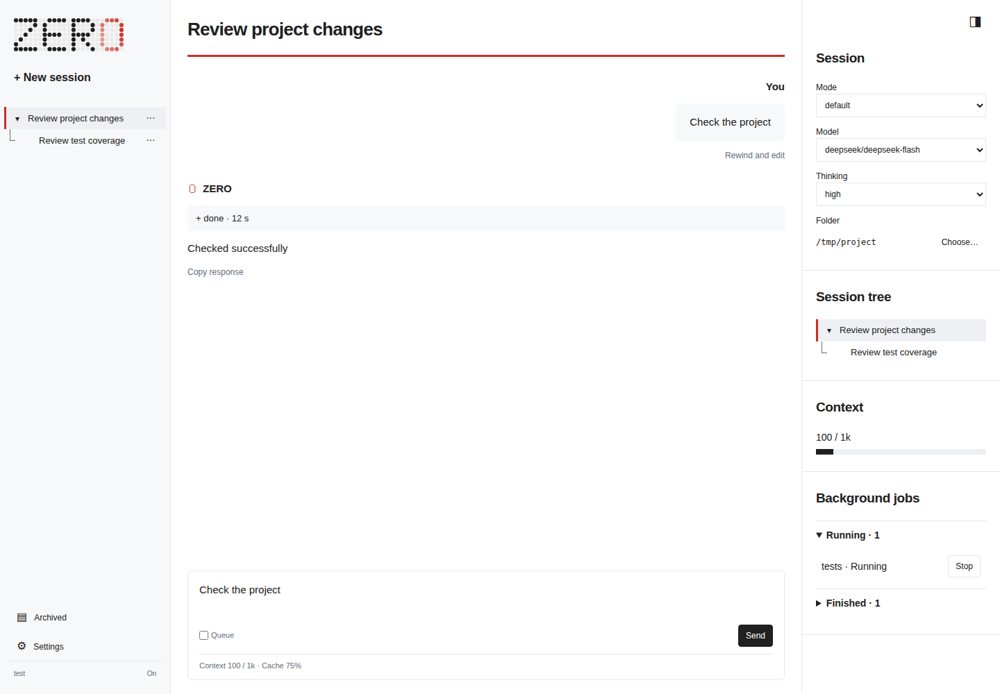

<p align="center">
  <picture>
    <source media="(prefers-reduced-motion: reduce) and (prefers-color-scheme: dark)"
      srcset="apps/web_ui/wordmark-dark-still.svg">
    <source media="(prefers-reduced-motion: reduce)"
      srcset="apps/web_ui/wordmark-light-still.svg">
    <source media="(prefers-color-scheme: dark)" srcset="apps/web_ui/wordmark-dark.svg">
    
  </picture>
</p>

<h3 align="center">A general purpose agent.</h3>
<p align="center"><sub>Zealous Efferent Response Operator</sub></p>

<p align="center">
  <a href="#install"><b>Install</b></a> · <a href="#use">Use</a> · <a href="#for-other-agents">For other agents</a> · <a href="#update">Update</a> · <a href="CHANGELOG.md">Changelog</a>
</p>

<p align="center">
  
  
  <a href="LICENSE"></a>
</p>

<p align="center">
  <picture>
    <source media="(prefers-color-scheme: dark)" srcset="docs/media/zero-web-dark.png">
    
  </picture>
</p>

<p align="center"><sub>The browser app in light and dark themes, shown with
illustrative session data. Run <code>zero</code> to open it;
<code>zero tui</code> opens the terminal app.</sub></p>

- **Any model:** any server that speaks OpenAI's Chat Completions or Responses API. ZERO ships a catalog (DeepSeek, OpenAI, Gemini, Qwen, Kimi, GLM, OpenRouter, Ollama) and takes servers of your own; no model is built in. What a model honours of its API (thinking off, strict JSON) is measured, and a setting it can't honour shows unavailable.
- **Many sessions:** each with its own workspace and history, opened, switched, renamed or archived from the browser or terminal.
- **Permissions you choose:** five modes, from read-only to never asking, a sandbox (bubblewrap), and a judge that answers in the auto modes, deciding only after it gives its reason and takes a second look at it.
- **One server:** it runs every session. Turns, background jobs and waiting questions go on after the browser or terminal closes, and every app reaches the server the same way.
- **Long sessions keep going:** near its line (the model's context window, or the one you set), a session's context is compacted: older outputs are saved to files, then ZERO writes itself a handoff. Nothing ZERO reads has a fixed cap: a long result past its share of the room is saved whole, and ZERO reads its start and end and where the rest is.
- **Long work in rounds:** leave ZERO a long job (or send it with `--rounds`) and it works in rounds, each a turn that starts fresh from the last one's handoff, until its done check passes, it is stuck, or you stop it. ZERO states its estimate (rounds, time, dollars) and is told once if the work passes it; nothing stops at it. In default mode the judge answers permission asks; a question about your intent still waits for your answer.
- **Subagents:** ZERO can start a session for part of its work, from a copy of
  the conversation or with its task alone. In default, it asks before handing
  work off: Yes, or don't ask again for hand-offs in this session. Once approved,
  the judge answers its permission asks against your words. The sandbox and
  stricter modes remain in force. The same admission applies to work in rounds.
  Subagents report back. A helper's question goes to its parent, which can
  answer that question by its id or ask you. Ordinary messages do not answer asks.
- **Workflows:** a script ZERO writes can call `zero -p TEXT` inside the
  sandbox. Its separate credential permits starting and following its own
  session's subagents, not answering asks or reading unrelated sessions.
  In default, a new hand-off waits for your approval; then the command receives
  the answer. `--model` selects another model, and `--mode` selects the same or
  a stricter mode for a new subagent. `--session ID` continues an existing one
  with its existing settings. A server restart revokes workflow credentials;
  pending asks remain, and interrupted commands are reported as before.
- **The means are ZERO's to pick, or yours to name:** a plain turn, background jobs, rounds, subagents. ZERO reads what each is for and what it costs, a note of its context's size as it grows with what every step then counts, and whether you would rather wait or have more tokens used (`time_or_tokens`, balanced as shipped). Name a means in your message and ZERO uses that one. For a result it has started, it holds the turn (`wait`) and answers once.
- **Session search:** ZERO searches what every session's log holds, running or done (your messages, its replies, each command with its output, the handoffs), by its words, and reads the records near a match; so does `zero session search`.
- **Rewind and fork:** Rewind returns to before your selected message. An
  earlier-point fork starts a new session there. Files and running work persist.
  Discarded messages stay in the log for explicit recovery. Ordinary model
  searches and the new branch’s notes omit the discarded conversation.
- **A fallback model:** when the session's model fails, the turn goes on with the one you set (`fallback_model`).
- **It trusts the model:** what the model reads states facts, never guardrails; the limits live in code; it is built for the models to come.

> [!NOTE]
> ZERO is in development (versions below 1.0): anything may change between releases. Each release is one checkpoint of its development, or a fix between two; [CHANGELOG.md](CHANGELOG.md) says what each brought.

## Install

ZERO runs on Linux; Windows and macOS come later in its development.

```bash
curl -fsSL https://github.com/jody0731/zero/releases/latest/download/install.sh | sh
```

Each release is one file for each machine, ZERO with its own Python inside (free-threaded CPython from [python-build-standalone](https://github.com/astral-sh/python-build-standalone), with the packages ZERO was tested with), so nothing else is installed: no Python, git or pip. The installer fetches the newest one for this machine, checks its sha256, and puts it in `~/.local/share/zero` (`--dir DIR` puts it elsewhere) and the `zero` command in `~/.local/bin` (`--bin DIR`). Then it runs `zero doctor`, which tries what ZERO needs from the machine (a command in the sandbox, its home) and lists what ZERO's files hold that it doesn't know; run it again any time. Nothing of ZERO's runs at login: systemd holds the port of ZERO's HTTP door (`127.0.0.1:4747`, for the web UI and other agents) and starts the door at the first knock.

<details>
<summary><b>The same, by hand</b>: one download</summary>

Download `zero-<version>-x86_64-linux.tar.gz` from the [newest release](https://github.com/jody0731/zero/releases/latest), then:

```bash
tar -xzf zero-*-x86_64-linux.tar.gz
zero-*/bin/zero install
```

The unpacked folder can go once it has installed.

</details>

<details>
<summary><b>What it needs</b></summary>

- Linux on x86-64 with glibc 2.28 or newer (Debian 10, Ubuntu 20.04, RHEL 8 and later); the installer needs `curl` or `wget`, `tar` and `sha256sum`
- [bubblewrap](https://github.com/containers/bubblewrap) (`bwrap`) and the system
  `libseccomp.so.2`: ZERO's sandbox and its filter for read-only commands.
  `zero doctor` checks both; a missing filter cannot run an unreviewed command.
- a model: an API key for a server ZERO knows (DeepSeek, OpenAI, Gemini, Qwen, Kimi, GLM, OpenRouter), or a server of your own that speaks OpenAI's Chat Completions API, such as Ollama or llama-server

</details>

<details>
<summary><b>When the sandbox can't start</b></summary>

bwrap needs unprivileged user namespaces. Ubuntu 23.10 and later restrict them (`kernel.apparmor_restrict_unprivileged_userns = 1`), and bwrap then fails with `setting up uid map: Permission denied`; `zero doctor` says so, and so does a command ZERO runs. Lifting the restriction lets bwrap start:

```bash
echo 'kernel.apparmor_restrict_unprivileged_userns = 0' | sudo tee /etc/sysctl.d/60-userns.conf
sudo sysctl --system
zero doctor
```

That lifts it for every program. Ubuntu's `apparmor` package also ships a profile that allows it for bwrap alone (`/etc/apparmor.d/bwrap-userns-restrict`), for where a release enables it.

</details>

## Use

### Connect a model

Run `zero` to open the browser, then **Settings → Models**. Enter a model name
and an API key for a known model server, or use **Add a model server** with its
name and API URL. **Test and connect** makes a small model call, which the server
may charge for, before saving the connection. Pick the default model for new
sessions in **Settings → General → Defaults**; the current session's model is
selected in its right panel.

The terminal app, `zero tui`, has its own first-run connection flow and
**/settings → Models and keys…**. Both apps use the same saved connections.

<details>
<summary><b>The same, by hand</b>: ZERO's files in <code>~/.zero/</code></summary>

```toml
# ~/.zero/config.toml: new sessions' model, server/model
model = "deepseek/deepseek-flash"
```

```toml
# ~/.zero/keys.toml (mode 600): each server's key
[deepseek]
api_key = "..."
```

```toml
# ~/.zero/models.toml: a server of your own, under a name of your choosing
[myserver]
url = "http://localhost:8080/v1"
context_window = 65536
```

Its models are then `myserver/<model>`. A server that speaks the Responses API takes `api = "responses"`. The catalog ZERO ships, with every field explained, is [model/catalog.toml](model/catalog.toml); a line in models.toml under the same name changes any of it. `zero model features myserver/<model>` says what the model honours of its API (`--test` measures again).

</details>

### Browser and terminal

```bash
zero
zero web
zero new
zero -r
zero tui
zero tui new
zero -p "a question"
```

`zero` and `zero web` open your default browser, at this folder's latest session.
`zero new` opens a new-session form; `zero -r` opens the session list. `zero tui`
opens the terminal app. `zero -p` remains the plain command for scripts.

A browser is paired on its first `zero web`. Its pairing has no time limit: opening
its saved address restores access even after the short-lived login cookie expires.
Clearing the browser's site data, using another browser profile, or replacing ZERO's
app token requires pairing again. The browser holds a separate browser credential,
never the app token or a model server key. Treat a paired browser profile as access
to ZERO. Host and Origin checks apply to every request.

The browser address is `http://zero.localhost:4747/`. On Linux, the optional clean
address is `http://zero.localhost/`. Prepare its systemd files for review with:

```bash
zero http-door system-units --output /tmp/zero-web-units
```

The command prints the administrator installation and removal commands. Only the
system holds port 80; the HTTP door still runs as your user and starts on demand.
Port 80 must be available on loopback. The existing MCP address on port 4747 remains
available. Without administrator setup, keep the address with the port. Do not run
ZERO itself as root to obtain the clean address.

The OS holds the listening port while ZERO sleeps. Opening the page starts the HTTP
door and the server as needed; both leave when idle. A visible page's light watches
alone do not keep the server awake.

Each turn has one ZERO heading. Its thinking, tool calls and background notices sit
inside an expandable process; replies remain visible. The process starts collapsed.
The input grows to ten lines, then scrolls. The line below it reports context usage
and the cached input-token share of the last model call, not a percentage of requests.

Session menus on the left offer rename, fork, history, archive, copy link and delete
(to the trash). Archived sessions have a separate view and can be restored. History
lets you rewind before a message; Fork creates a new session from the left menu. The right panel edits the session's mode,
model, thinking and folder, and shows its jobs. Stop one job or all this session's
running jobs; each stopped job's output and exit status still reach ZERO.
Running and Finished jobs have separate expandable groups. The compact session tree truncates
long titles, shows their full name on hover and lets you expand branches. Model and mode are dropdowns;
**Choose…** opens a folder browser with Home, parent folders and recent workspaces.
These session controls apply on selection, without an Apply button.

ZERO opens with its answer. Click **Why** or **Next** to fold that section.
Empty sections take up no space. Next gives your action before ZERO’s.

**Copy response** copies one ZERO turn's answer as Markdown, excluding its process.
**Rewind and edit** returns to before a user turn and puts its message back in the
composer. Confirming it leaves later conversation behind; files and memory do not
rewind. Unsent text is saved per session in this browser, including across reopening.
A draft clears only after a successful send; newer edits stay. If browser storage is
unavailable, the composer says the draft is kept only in the current tab.

**Settings → General → Appearance** selects System, Light or Dark for this
browser; the choice applies immediately. The dotted wordmark respects reduced
motion, and the standalone O marks the browser tab. Both session panels share
compact tree rows and expansion state. Selection changes the highlight, not the
row height. Browser Find searches
loaded conversation text; ZERO can retrieve context from other sessions itself.

Type `/` for commands; `/quit` belongs to the terminal, so close the browser tab to
leave the web app. Settings groups Appearance and Defaults under General, with separate Models
and Advanced tabs. Advanced uses labeled Judge, Limits and Server subsections;
Model under Judge selects the judge's model. Edits stay while switching tabs and apply on
**Back** or Escape; rejected values keep the view open with an inline error.
Reading settings or model capabilities makes no
paid model call. **Test and connect** explicitly tests a model server with a small
call, which that server may charge for. Terminal themes and keys remain in the TUI.

### CLI

Everything a caller does has a command, named as its message: a family, then the action.

```bash
zero session send "a task" --cd ~/project --json   # one result object when it settles; --rounds
zero session list                                  # read, watch, stop, continue, compact, rename, archive, delete, set
zero session search proxy port                     # what every session's log holds; --session ID, --around N
zero session rewind ID [SEQ]                       # back to before your message SEQ; with no SEQ, your messages
zero session fork ID [SEQ]                         # a new session from this one, up to SEQ or all of it
zero job list                                      # job stop JOB
zero rounds list                                   # rounds stop ID
zero grant list ID                                 # grant forget ID GRANT
zero model server list                             # probe, connect, disconnect
zero model features MODEL                          # what it honours of its API; --test
zero setting set max_subagent_depth 1             # setting list
zero server status                                 # whether the server runs and what keeps it busy
zero doctor                                        # what ZERO needs from the machine, tried
```

<details>
<summary><b>Names, input, output and exit status</b></summary>

- A session or a job is named by its id or the start of it.
- A long text can come from stdin (`-`); a key only does (`--key-stdin`), never as an argument.
- `--json` prints one result object. On completion, `zero -p TEXT --json` includes
  the readable `answer` and a structured `reply` with `answer`, `why`,
  `next.user` and `next.zero`. Answer contains text. The other strings can be empty. The result
  also includes the session, outcome, any waiting question, tokens and seconds.
- The exit status is 0 when it worked, 1 when not, 2 when a question waits: answer it with `zero session send TEXT --session ID`, or pick its displayed choice with `--choice KEY` (a number for a question;
  `yes`, `session`, `saved` or `no` for a permission ask).
- `zero -p TEXT` is short for `zero session send TEXT`.

</details>

### Skills

ZERO uses skills by the [Agent Skills](https://agentskills.io) standard: a folder with a `SKILL.md` that says what the skill is for and how to do it, often with scripts beside it. It finds them in `~/.agents/skills` (shared by the agents on your machine), `~/.zero/skills` (ZERO's own) and a project's `.agents/skills`, nearest first. Its system message lists each one with its description; ZERO reads a skill in full when a task calls for it, and the skill's scripts run as any command does, under the session's mode. `zero doctor` names any skill ZERO can't use as it is.

ZERO writes skills of its own too, from its work, when you ask or when it judges one worth keeping: `write_skill` puts a skill (its `SKILL.md` and its scripts) in `~/.zero/skills`, whole or not at all, and every session that starts after lists it. Each write asks first, in every mode (you in `default` and `bypassPermissions`, the judge in `auto` and `auto+`), as a change to ZERO's own files does: a skill reaches every later session. A name another skills folder uses is left to that folder.

### MCP servers

ZERO uses the tools of [MCP](https://modelcontextprotocol.io) servers: a command
it starts (stdio) or a URL (Streamable HTTP). List one with
`zero mcp add NAME -- COMMAND ARGS`, `zero mcp add NAME --url URL`, or copy an
entry with `zero mcp add NAME --from claude` (or `--from codex`). `--tools a,b`
offers only those tools. `zero mcp list` shows each server and its state;
`zero mcp get NAME` shows its tools and last words on stderr;
`zero mcp get NAME --json` also reports whether it is sandboxed;
`zero mcp remove NAME` takes it off.

Local servers start in a read-only sandbox by default: no writable files,
scratch, network or socket connections. Their tools need no permission review;
a server's own read-only hint never decides this. A server needing writes or
connections must be added with `--outside-sandbox` (or `outside_sandbox = true`
in its entry). HTTP servers are outside the sandbox. Their calls ask in
`default`, go to the judge in `auto` and `auto+`, and are refused in `readOnly`.
"Don't ask again" covers every tool of that named server, for this session or
saved for later sessions. Older permissions for individual tools stay narrow.
Existing entries without the new field become sandboxed; their files are not
rewritten. A server that cannot start inside stays failed until reconfigured.

ZERO starts listed servers when its own server starts and stops them with it.
One process is shared across sessions. Its tools are `mcp__NAME__TOOL`, marked
as the server's own words. Each server's tools are sent whole while they fit
5% of the context; otherwise ZERO finds them with `tool_search` and calls them
with `call_tool`, under the same permissions. Commands inherit only `HOME`,
`LOGNAME`, `PATH`, `SHELL`, `TERM`, `USER`, the entry's `env` and sandbox scratch.

### Read-only commands in auto+

A bash call marked `no_changes=true` runs without judge review in a read-only
sandbox, with no writable scratch, network or socket connections. If a
foreground command fails, it is retried once without the mark through the
ordinary judge and permission checks. The failed attempt stays in the log.
A background job stays confined; a timeout or stop never triggers that retry.
An unavailable sandbox fails closed. Unmarked calls keep their normal mode's
behavior. ZERO chooses the mark; it can still send an unmarked read for review.
Reading the internet uses `web_fetch` or `web_search`, without review; local
network access keeps its existing permission checks.

### Private credentials

Ask ZERO to save a credential, giving its site and username. ZERO fills the
labels and asks for values in masked fields. Enter the password there, outside
chat. You can ask ZERO to find, update or delete a saved entry.

ZERO opens the masked form through its vault add/update call; saving resumes
the task with the entry ready to use. Passwords, keys and session cookies
use this same path. Every requested secret field needs a value.

ZERO uses `⟦vault:name/part⟧` in tool arguments. The harness substitutes the
value just before execution and redacts known values from returned text and
saved output. A one-part entry also accepts `⟦vault:name⟧`. Redaction covers
exact values and common URL, HTML, JSON and base64 encodings; arbitrary
transformations and images are not covered.

The whole `vault.enc` file, labels included, is encrypted. Its encryption key
uses an available OS keyring or an owner-only `vault.key` inside ZERO's home.
Backups need both the vault and its original key. `zero doctor` and
`zero vault status` report the selected key store. Existing model API keys
remain in `keys.toml`.

For a pending CLI request, run `zero vault answer SESSION` in a terminal for
masked prompts, or append `--cancel`. Values are never command-line arguments.

## For other agents

ZERO is an MCP server at `http://127.0.0.1:4747/mcp`, on its HTTP door: every session of every agent uses the one door, and none starts a ZERO process of its own. In Claude Code:

```bash
claude mcp add --transport http --scope user zero http://127.0.0.1:4747/mcp
```

In Codex:

```bash
codex mcp add zero --url http://127.0.0.1:4747/mcp
```

Or tell the agent to use ZERO: `zero --help` ends with these lines, with your port, for it to run itself. An entry that runs `zero mcp serve` goes first (`claude mcp remove zero --scope user`, `codex mcp remove zero`). The door knows each caller by its connection, as the socket does, so the line holds no token. For an agent that speaks only stdio, `zero mcp serve` serves the same tools there.

| Tool | What it does |
| --- | --- |
| `zero_start` | hands ZERO a task in a folder, in a mode; returns the session's id at once |
| `zero_wait` | returns the result when the session settles |
| `zero_reply` | answers a waiting question, or sends a follow-up |
| `zero_stop` | stops the running turn |

The mode decides who answers permission asks: in `default` the calling agent
does, with `zero_reply`; in `auto` and `auto+` ZERO's judge does. Questions
about the task wait for an answer through `zero_reply` in every mode.

## Apps in any language

The full screen, the web UI, the commands and the MCP server are apps of ZERO's server, and a program in any language can be one. `zero server start --json` starts the server when none runs and names the way in:

```json
{"ok": true, "socket": "/home/you/.zero/run/zero.sock", "token_file": "/home/you/.zero/app-token", "protocol": 5, "version": "0.7.6.1", "pid": 4242}
```

A request is one JSON object on a line, answered by one line; [`protocol/schema.json`](protocol/schema.json) describes every message, its reply and the rows replies carry. Name the protocol in each request (`"protocol": 5`). A message that changes something (marked `x-changes`) carries an `id` you pick, new for each message: send the same id again when you don't know whether it got through, and it runs once, its first reply coming back marked `replayed`. A reply may carry fields your app doesn't know yet; read what you know. A program of yours on this machine is known by the socket itself; where it isn't (a relay, a container), put the token file's text in each request's `token`. The token lets your apps in and nothing more.

```python
import json, socket

with socket.socket(socket.AF_UNIX) as s:
    s.connect("/home/you/.zero/run/zero.sock")
    s.sendall(b'{"message": "server/hello", "protocol": 5}\n')
    print(json.loads(s.makefile().readline())["modes"])
```

Over HTTP, the door takes the same request at `POST http://127.0.0.1:4747/api/request` and answers with the reply; it knows a program of yours by its connection, and where it can't, `Authorization: Bearer` with the token file's text lets it in.

## Update

```bash
zero update
```

It fetches the newest release for this machine (its code, its Python and its packages together), checks its sha256, tries it (its version, and that its Python loads ZERO's server), then switches to it in one step and shows what it brought; until that step the release you had runs, and a failed update leaves it running. The one before stays until the next update, unless something still runs from it. `zero --version` says which release you have. The server picks up the new code once it is idle, and the update replaces a running HTTP door automatically, even when its systemd
unit files have not changed. A stopped door stays stopped until needed. Refresh
an open browser tab to load the new UI; no manual service restart is needed.
An update also keeps the door's systemd units in place. It never touches `~/.zero`.

<details>
<summary><b>From a git clone</b>: ZERO before 0.7.5.3</summary>

ZERO was once a git clone with a Python environment of its own (`~/Applications/zero`). Its `zero update` checks out the newest release, and on its next start that release moves the install: it fetches its own archive, switches to it in `~/.local/share/zero`, points the `zero` command at it and runs your command again. If the move can't finish, the clone runs on as before, and the move is tried again an hour later, or at once with `zero update`. The next update removes the clone once it holds nothing of yours and nothing runs from it. `ZERO_RELEASES_URL` names a mirror of the releases, laid out as GitHub's.

</details>

## Where things are

| Path | What it holds |
| --- | --- |
| `~/.local/share/zero/` | ZERO's releases, each in `versions/` with its own Python; `current` names the one that runs |
| `~/.local/bin/zero` | the command, which runs `current` |
| `~/.agents/skills/` | the skills the agents on your machine share, which ZERO reads too |
| `~/.config/systemd/user/zero-http-door.socket` | systemd's hold on the HTTP door's port, with `zero-http-door.service` beside it; `zero http-door uninstall` takes them away, `zero http-door install` puts them back. The port is `[http_door] port` in `config.toml` |
| `~/.zero/app-token` | the token an app sends where the socket can't tell who it is, mode 600; removed, a new one is made |
| `~/.zero/mcp_servers.toml` | the MCP servers whose tools ZERO uses (`zero mcp add`), mode 600: an entry's `env` and `headers` may hold tokens |
| `~/.zero/` | everything ZERO keeps, moved by `ZERO_HOME`: your settings (`config.toml`), keys, model servers, `SOUL.md` (who ZERO is) and `ZERO.md` (your instructions and its memory), its own skills (`skills/`), and in `state/` the sessions and their history (`state/sessions/results/` holds the outputs kept out of a session's context; `state/session_search.sqlite`, the search's index, is made again from the logs whenever it's gone) |

## Uninstall

```bash
zero uninstall
```

It removes the command, the HTTP door's units and `~/.local/share/zero`, once ZERO's server has stopped (`zero server stop`); `~/.zero` stays, yours to remove.

---

<p align="center"><sub>MIT license (a release's Python and packages under their own, inside it) · <a href="CHANGELOG.md">Changelog</a> · <a href="protocol/schema.json">Protocol schema</a></sub></p>


### Questions and keywords

ZERO can use `ask_user` when an answer is worth your attention. Questions are
shown separately from permission asks, with number keys for suggested answers
and free text for your own answer. The turn waits, including after reconnect
or restart; the judge cannot supply the answer. `zero -p` reports "waiting for
an answer" and exits with status 2.

The shipped system message defines two words: `autopilot` asks ZERO to decide,
keep a list of its decisions and report when done, asking only for what it
cannot do or find out itself. `override` means you take responsibility for your
request and want it carried out as asked; that meaning applies only to your
own message. Permission modes and judging still apply to both.

Add your own meanings under `# Keywords` in ZERO.md. A meaning there replaces
ZERO's shipped meaning of the same word. The judge reads them too. Updates
replace the shipped definitions and leave your ZERO.md untouched; the section
is included at the top of new ZERO.md templates.


Private information requests explain what each masked field needs and where
to find it. Save with Continue to resume the task. From the command line,
`zero private-input SESSION` opens the same guided request; `--cancel` declines.
The existing `zero vault answer SESSION` command still works.
